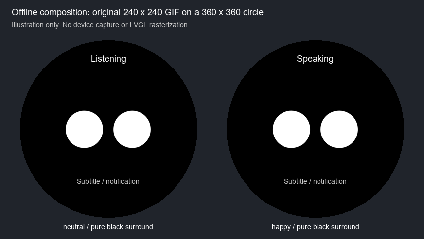

# O：0015 Otto 整屏黑底适配

日期：2026-10-15，Asia/Shanghai。分支 `codex/otto-black-background-20261015`，基线 `ffbdfd758ccea91e0829b2e0ae720fea9ccd450c`。本记录覆盖修复和离线交付；未打开串口、读取设备备份/NVS（非易失存储）、重置或烧录。0014 真机照片暴露的白色外圈是待修缺陷，不能作为旧版本视觉验收通过。

## 范围与实现

240×240 原 Otto GIF 居中显示在 360×360 圆屏，原图不重编码、不缩放、不换素材。0014 `ApplySkinStyles()` 只写 container/top/bottom 的颜色，未统一根屏幕与背景透明度；通用 `LcdDisplay::SetTheme()` 还可能给 container 安装主题背景图片，并给静音等标签设置浅色主题的黑色文字。这是源码事实；未读取或推断设备具体的皮肤/NVS键值，未按照片拍摄角度修改旋转。

新增板级 `ApplyViewStyles()`：

- Otto 使用 `#000000`，根屏幕取自 `lv_obj_get_screen(container_)`，根屏幕和全尺寸容器均完全不透明，顶部黑底，字幕底保持透明；清除根屏幕、容器、上下栏和 emoji 盒子的主题背景图片覆盖。
- 状态/通知为 `#FFFFFF`，字幕/网络/电量/**静音**为 `#C8C8C8`；对黑底理论对比度分别为 21:1 和约 12.55:1。低电量警告原有独立底色与白字不改。
- 实际 SetupUI、主题重设和皮肤重设后强制覆盖；实际 ApplyFace 仲裁后根据当前运行视图及活动 Otto 判断样式。缓存外观模式，40 ms 仲裁无需重复写相同样式。
- 显式壁纸视图恢复保存的皮肤颜色与当前主题背景图，恢复半透明顶栏，字幕仍透明。壁纸暂不可用而回退到 Otto 时先黑底，恢复壁纸时恢复其外观。Otto→壁纸→Otto 不修改持久视图、皮肤或壁纸设置。

保留 272×58 字幕栏、252×48 字幕标签及原位置。不新增 NVS/壁纸写入路径，不改动存储、服务、GIF 解码器、状态模型或资源格式。源码只有板级显示文件与 CMake 版本号变化。真实源码为 `D:\Dev\esp-projects\smart-ring\otto0015`，由本机已完整取得的 `otto0014` 创建实体副本；无联接，不编辑基线、原 `src` 或旧 build。

## 补丁与可恢复性

交付 [0015 增量补丁](../../../firmware/smartring_plus/patches/0015-otto-black-background.patch)及[机器可读记录](../../../firmware/smartring_plus/experiments/0015-otto-black-background.json)。应用顺序为 restore-0012 → 0013 → 0014 → **0015**，0015 不能直接应用到厂家或 0013 源码。零上下文，使用 `git apply --unidiff-zero`；先核对下面两个原始文件摘要。补丁 LF（换行格式）由精确 `.gitattributes` 条目固定。

| 文件 | 0014 原始 SHA-256 | 0015 目标 SHA-256 |
|---|---|---|
| `CMakeLists.txt` | `249820e3e0396720154104ad0836728a4a245ecbd19162711e45c893860aa61c` | `b3e2212c8a3f7f7d5fbf9ac55879e0a81dd3b25a9ddb05257f7b03296cb4ad14` |
| `main/boards/viewe-smartring-plus/viewe-smartring-plus.cc` | `636942d8ae6cb4f7a336f14be5199c737f8c234c6a04525ba27dfb91851bb274` | `ddc0401177cd020d4a21afeecf40e627cfaea7c02a45870764afed49066c9d47` |

原始字节与 LF 归一化摘要相同。`otto0015-audit2` 新夹具执行正向 check、实际应用、两个目标摘要比较、反向 check、实际反向应用及两个原始摘要比较，全部通过。`audit1` 也完成正反向还原，随后记录脚本误用不存在的 project_dir 字段而退出；核对实际 project_path 字段后使用新夹具完成记录，没有修改源码或产物。

## 实际离线验证

[O 宿主测试生成器](../../../tests/unit/firmware/otto_black_background.py)复用 N 的公开方法抽取与 GIF 脚手架。最终夹具 `D:\Dev\esp-projects\smart-ring\otto0015-host3`，`result.log` 有两个 PASS，无遗留跟踪分配/计时器。测试脚本、实际导入源码和 21 原始 GIF 摘要均在 JSON 中登记。

- 实际板级 SetupUI/SetTheme/ApplySkinStyles/ApplyViewStyles，以及实际 GIF 显示、清理、壁纸加载、视图切换与状态方法均编译执行；ApplyFace 保留真实仲裁前缀，几何脸绘制不在本次宿主检查内。
- 底层 LCD 主题写入、LVGL（轻量图形库）对象/样式/计时和分区存储使用桩。主题桩主动重写白色背景、背景图与黑字，再由实际板级方法恢复；未把测试桩当成真实 LVGL 渲染。
- 启动、主题初始化前调用、显式浅色主题、重复主题重设、旧白底皮肤重设、全部七种 Otto 状态、打断、21 张真实原图切换、30 次 Otto↔壁纸往返、缺壁纸失败、无背景图片主题均通过。检查根屏幕/容器颜色和不透明度、背景图移除/恢复、全部文字/图标颜色、真实图片可见标记及 240/360 尺寸、字幕尺寸位置。
- N 的原有真实解码器错误/重试/暂停/结束和安全释放回归也通过。没有重跑历史 21 图各 100 次完整解码循环；本次 21 图是实际显示切换和首帧解码。
- 四个宿主负向对照分别故意漏改根屏幕、背景图片、不透明度、静音标签；四项均触发对应断言（退出码 31），证明检查能拒绝这些遗漏。对照只改变生成夹具，不修改固件。
- 首轮 host1 的新增 C 桩遗漏形参名导致编译失败；修正测试桩后 host2/host3 通过。负向对照首次命令把多个源文件配一个 `/Fo` 失败；改为逐文件编译/链接后四项正确拒绝。这些失败不属于固件构建失败。

复验命令（普通 PowerShell，工作目录为本工作树；output 须选未存在的 ASCII 目录）：

```powershell
& 'D:\Dev\esp\python_env\v5.5.4\venv\Scripts\python.exe' -X utf8 -B tests/unit/firmware/otto_black_background.py --source 'D:\Dev\esp-projects\smart-ring\otto0015' --fixed-gifs 'D:\03-项目\01-正式项目\智慧圆屏\local\runtime\otto-emoji\970cf66906d7c30059faa2704e7002f06b8c3619\gifs' --output 'D:\Dev\esp-projects\smart-ring\otto0015-host-new'
powershell.exe -NoProfile -ExecutionPolicy Bypass -File 'D:\Dev\esp-projects\smart-ring\otto0015-host-new\run.ps1'
```

宿主编译器为本机 MSVC 14.51.36231，经 `Enter-Cpp.ps1` 仅在子进程加载。原 GIF 的来源提交/大小/Git blob摘要均核对，未联网取得资源。

## 编译产物与保护证据

新目录 `D:\Dev\esp-projects\smart-ring\build-otto0015-clean1` 从空目录配置并完整编译 2164 个动作通过，禁用 ccache（编译缓存），Python 外部 DNS/网络连接护栏生效。固定 SDK 5.5.4 提交 `735507283d5b2f9fb363a1901172dbd9e847945d`，专属 Python `D:\Dev\esp\python_env\v5.5.4\venv\Scripts\python.exe`；CMake 3.30.2、Ninja 1.12.1、Xtensa GCC esp-14.2.0_20260121 均来自 `D:\Dev\esp\tools`。project_description 的源码目录、板型 sdkconfig、ESP32-S3、版本 `2.2.3-otto0015` 核对一致。未进行第二个独立干净目录重建。

| 交付 | 精确值 |
|---|---|
| 唯一待交 K 的应用 BIN | `D:\Dev\esp-projects\smart-ring\build-otto0015-clean1\xiaozhi.bin` |
| 字节 | **3,991,024** |
| SHA-256 | **`e3f3582a434701ef1637e22731c4e05a456fccb114ebe1efd570c0469b52befe`** |
| 应用槽容量 / 余量 | **4,128,768 / 137,744 字节**，编译器报告约 3% 余量 |
| 镜像检查 | esptool 4.12.0 离线 image_info：ESP32-S3，Checksum 与 Validation Hash 均 valid |

全源码副本逐字节比较 10,765 个文件（仅排除 `build-*.log`），变化只有上述两个文件，包含 managed components 的其余文件均相同。sdkconfig、dependencies.lock、分区表和生成的默认 assets 与 0014 clean5 字节相同；完整产物摘要见 JSON。该默认 assets **不是**设备当前保留资源包，不需要也不得因本次交付烧录它。

本次修复只需**实际当前活动应用分区**。不需要 assets 更新，不更换/重打包任何资源，不写引导器、分区表、OTA 数据、NVS、A/B 壁纸或另一应用槽。应用地址由 K 核对同一设备及当前布局/活动槽后确定，不照搬 0014 地址或默认 flash_args。本会话没有取得或使用设备数据，离线相同证据不能代替 K 对新检查点和实际保护区域的读回校验。

## 预览、限制与交接



此图是原 neutral/happy 首帧原尺寸居中、文字示意的 Pillow 合成，已目视核对；不是 LVGL 光栅渲染或真机证据，没有修改 GIF。真实边缘、主题切换体验、面板刷新、声音和打断仍须设备验收。

素材沿用已有 [MIT 许可](../../../firmware/smartring_plus/otto/LICENSE.MIT)。新文档和清单的 strict（严格）检查通过，零 warning/error；一条 note 为检查器按 experiments 路径跳过 JSON 链接，已人工检查该公开 JSON。检查器需要项目 Python 3.12；初次误用 SDK Python 3.11 缺少 pathlib.is_junction，换回正确解释器后通过，未改检查器。源码关联候选已核对，本次为窄范围修复而不改写旧 0014/架构历史结论。`git diff --check` 通过，未运行远程 CI。

所有者最新授权已覆盖本轮修复完成后直接更新；O 仍止于代码/离线交付，由主会话审查后安排唯一串口操作者 K 取得本轮新备份，执行仅应用更新、独立读回及保护范围核验。不得复用旧许可扩大范围。

未修改根 README/CHANGELOG/ROADMAP/AGENTS、主任务书或历史验收记录。新增记录只登记本次清单条目与关联；未宣称旧指南整篇重新验收。主会话负责整合和推送，本分支只提交，不合并、不推送、不向其他会话发消息。
